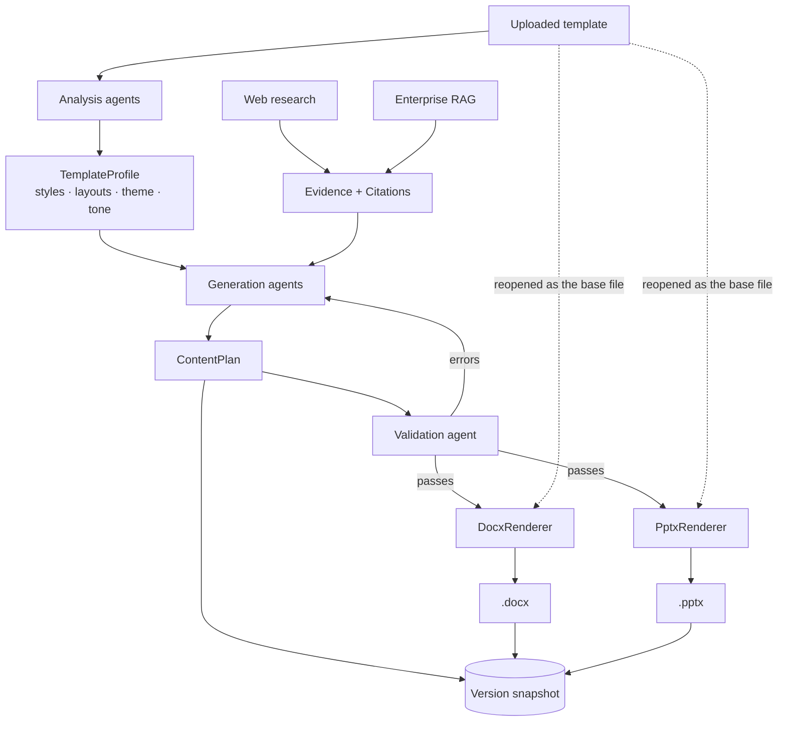
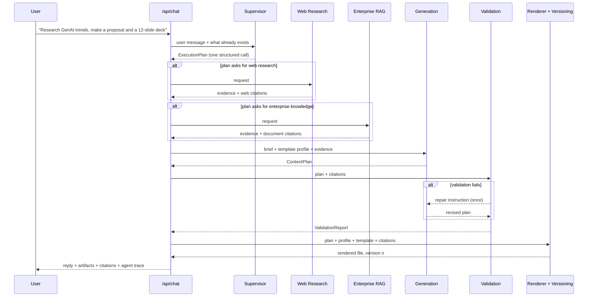
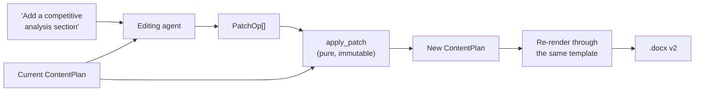

# Architecture

## The core idea

Everything hangs off one decision: **an artifact is a `ContentPlan`, and a
DOCX or PPTX file is only ever a rendering of it.**



The dotted lines are the important ones. The renderers do not build a new file
and try to imitate the template — they **open the uploaded template itself**,
clear its body, and write the new content back through the styles that template
already defines.

Everything that gives a corporate document its identity lives *outside* the
body: theme fonts and colours, numbering definitions, the style table, headers
and footers, page geometry, slide masters and layouts. None of it is touched.
It is inherited, so it cannot drift.

---

## A turn, end to end



### Why the supervisor decides once

The supervisor makes **one** structured call that returns a complete
`ExecutionPlan` — intent, which specialists to invoke, what to produce, and the
brief each producer gets. The rest of the turn is deterministic sequencing that
follows that object.

Letting a model re-decide after every step is where multi-agent systems become
slow, expensive and impossible to explain. A single auditable routing decision
is displayed in the UI and followed by ~200 lines of readable orchestration.

---

## Layers

| Layer | Responsibility | Depends on |
|---|---|---|
| `api/routes` | HTTP, validation, serialisation | services |
| `services` | Use cases: upload, chat, versioning, patching, conversion | orchestration, rendering, db |
| `orchestration` | Sequences agents, emits the trace | agents |
| `agents` | The nine specialists | analysis, rag, search, llm, core |
| `rendering` | ContentPlan → DOCX/PPTX | core models |
| `analysis` | Upload → TemplateProfile | ingestion |
| `ingestion` | File → ExtractedDocument | — |
| `rag` / `search` / `llm` | Provider abstractions | config |
| `core` | Models, errors, logging | — |

Dependencies point inward. `core` imports nothing from the app; `api` imports
from everything. No layer reaches back up.

### Every external service is a protocol

```python
class VectorStore(Protocol):
    def add(self, chunks: list[Chunk]) -> int: ...
    def search(self, query: str, top_k: int) -> list[SearchHit]: ...
```

`LLMProvider`, `VectorStore`, `SearchProvider` and `Transcriber` are all
abstractions with two or more implementations. That is why the entire test
suite runs with no network access and no API key, and why swapping Chroma for
Pinecone is one environment variable.

---

## The content model

```python
DocumentPlan(title, subtitle, sections=[
    Section(id="sec1", heading, level, blocks=[
        Block(id="b1", kind="paragraph"|"bullets"|"table"|..., citation_ids=[...])
    ])
])

DeckPlan(title, subtitle, slides=[
    Slide(id="sld1", layout, title, bullets, speaker_notes, citation_ids=[...])
])
```

Ids are short and stable (`sec1`, `sld3`) because patch operations target them
by name and a language model has to emit them reliably. A UUID in a prompt is
expensive and easy for a model to corrupt.

Citation ids live on blocks and slides, so attribution survives every edit,
every conversion and every version.

---

## Editing without losing formatting



The editing agent never sees the binary file and never emits one. It sees an
*outline* of the plan — ids, headings, sizes — and returns operations.
`apply_patch` is pure: the parent version's stored plan remains exactly what
was rendered for it, which is what makes the version history honest.

An operation naming an id that no longer exists is skipped with a warning
rather than raised. Losing one edit is a far better outcome than failing the
user's whole turn.

---

## Traceability

```
Block.citation_ids  →  Citation.id  →  URL, or document + page
```

Three things enforce this rather than merely hoping for it:

1. The generation prompt is told the exact set of valid ids.
2. Any id outside that set is **stripped before rendering**, so a fabricated
   source can never reach the References section.
3. The validation agent **fails** a plan whose ids do not resolve, and
   measures what share of substantive content carries a source at all.

---

## Persistence

```
conversations ──< messages (with the agent trace, for replay)
              ──< uploads  (stored file + style profile + extracted text)
              ──< artifacts ──< artifact_versions
                                  ├── plan      (the snapshot)
                                  ├── ops       (what produced it from its parent)
                                  ├── citations (resolved at that moment)
                                  ├── validation
                                  └── file_path
```

Nothing is updated in place except an artifact's pointer to its newest
version. Every version stays downloadable.

SQLite by default — a POC's database should be one file a reviewer can open.
No SQLite-specific SQL is used, so moving to Postgres is a URL change.

---

## Concurrency

Route handlers are synchronous `def`, not `async def`. FastAPI runs sync
handlers on a worker thread pool, which is right for this workload: rendering
Office files and computing embeddings are CPU-bound, and the provider SDKs are
used synchronously. Going async would add plumbing without adding concurrency,
and would risk blocking the event loop on CPU work.

---

## Security

| Concern | Control |
|---|---|
| Path traversal | Every filesystem access goes through `resolve_within()`, which resolves the path and rejects anything outside its base directory |
| Malicious uploads | Extension allowlist, 25 MB cap, magic-byte check, and ZIP-content inspection so a DOCX cannot pose as a PPTX |
| User-controlled filenames | Never used as a path component; uploads are stored under a generated UUID and the original name is metadata only |
| Secret leakage | The logger masks vendor key shapes *and* the literal configured values, on every record |
| Error disclosure | Errors carry two messages: a public one for the client, a detailed one for the log |
| Access | Optional `X-API-Key` shared secret, compared in constant time; in-process rate limiting; CORS pinned to localhost |
